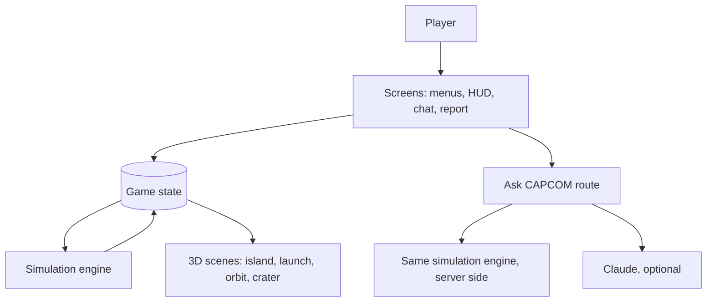

# Mission Island

### A Space Mission Design Game · NASA Space Apps Challenge 2026

Design a space mission on an island spaceport, launch it, fly it day by day, and find out whether your choices were good enough. On the Moon, send a rover into a crater that has not seen sunlight for billions of years.

> Mission Island is an independent student project created for the *Space Mission Design Game* challenge of the NASA Space Apps Challenge 2026. It is not a NASA product and is not endorsed by NASA.

---

## The Problem

Designing a space mission is a chain of connected trade-offs. A better instrument returns more science, but it also adds mass, draws more power, produces more data than the antenna can send home, and costs money that could have bought a bigger rocket. Students rarely get to try a whole mission themselves, and most learning tools teach one topic at a time (orbits, or rockets, or spacecraft). The trade-offs between them stay abstract.

Mission Island turns those trade-offs into something you can try, fail at, understand, and try again.

## The Game

The player starts with a science objective, not a ready-made spacecraft. Every decision must serve that objective and survive the realities of space.

1. **Read the mission.** Mission Control explains the goal, the money limit, how long the spacecraft must survive, and which real NASA missions tackled the same question.
2. **Walk the island and design.** Five buildings, each a part of the mission:
   - **Launch Complex:** where to go (6 orbits) and which rocket gets you there (4 launch vehicles).
   - **Assembly Hangar:** the spacecraft itself: structure, power, battery, flight computer, pointing system, engine, and on the Moon mission a rover.
   - **Science Lab:** which of 10 instruments to fly.
   - **Ground Station:** antenna, ground network, relay, and how much of the time the instruments observe.
   - **Mission Control:** the design review, which blocks the launch until the design is physically possible.
3. **Launch.** A short cinematic, and the rocket can fail at its real reliability.
4. **Fly.** The mission runs day by day. Solar panels age, radiation strikes, data piles up faster than it can be sent home, and surprise events demand decisions.
5. **Shadowline (Moon mission).** Land near the lunar south pole and plan a rover route into a permanently shadowed crater to find ice, then get back to sunlight before the battery dies.
6. **Debrief.** A grade, a plain-language explanation of what went well and what to fix, and a side-by-side comparison with the closest real NASA mission.

A full run takes about ten minutes, and the report always leads back to the island to improve the design.

## Missions

| Level | Mission | Difficulty | Goal | What makes it hard |
|---|---|---|---|---|
| 1 | **Wildfire Watch**: spot wildfires from orbit and map burn scars | Easy | 45 science in 3 years, $180M | Thermal and hyperspectral images produce more data than a small antenna can send home |
| 2 | **Space Weather Sentinel**: warn Earth about solar storms from the L1 point | Medium | 40 science in 5 years, $300M | Radio links at 1.5 million km and a long lifetime |
| 3 | **Lunar Ice Prospector**: map water ice at the Moon's south pole, then drive into a crater | Medium | 50 science in 2 years, $320M, plus the rover | Batteries in permanent shadow, and crater rims that block radio contact with Earth |
| 4 | **Mars Climate Orbiter**: study dust storms and ice caps from Mars orbit | Hard | 42 science in 3 years, $420M | 43% sunlight, a braking burn to enter orbit, and a slow interplanetary radio link |
| 5 | **Sandbox** | Free play | None | Nothing: experiment and compare reports |

There is no single correct design for any mission. Different combinations of orbit, rocket, parts and instruments can all succeed.

## How It Works

### Six resources

| Resource | What it means |
|---|---|
| **Weight** | Spacecraft mass. It must fit both the structure's carrying limit and the rocket's capacity to the chosen orbit; rockets lift far less to the Moon or Mars than to low orbit. |
| **Power** | Electricity made versus used, averaged over the time spent in a planet's shadow. Solar power fades with distance from the Sun; nuclear power works anywhere but produces little. |
| **Money** | Parts, assembly and testing, the rocket, and the flight team for every year of the mission. Real projects run over budget, so spare money matters. |
| **Data home** | How much of the science data the antenna and ground stations can send to Earth each day. Data that does not fit is lost. |
| **Must survive** | How long the spacecraft has to keep working, plus the travel time to far destinations. |
| **Science** | The score that decides whether the mission succeeds. |

### The design review

Some problems **block the launch** because the mission is physically impossible: the rocket cannot reach the orbit, the spacecraft is too heavy, the engine cannot brake into orbit, or the money has run out. Other problems are **allowed but costly**: not enough power, a battery too small for eclipses, an antenna too slow for the data, or aiming that is too coarse for a telescope. The game explains each one and offers a *Fix* button that jumps straight to the right choice.

### Science

Every instrument has a base value, and how much of it counts depends on how well it suits the mission, whether the orbit lets it see its target, whether the spacecraft can aim it precisely enough, whether there is power to keep it switched on, and how much of its data reaches Earth. The most valuable data is always sent first, so a weak antenna hurts data-hungry instruments most. A great instrument is worth little without the power, pointing and radio to support it.

### In-flight events

Seven kinds of event can strike during flight: a solar storm, a reaction wheel failure, a ground station outage, a budget cut, space junk on a collision course, a micrometeoroid strike, and an unexpected discovery. Each event explains what it means *for your spacecraft* using its real numbers (for example, the chance that a standard computer is damaged by radiation compared with a radiation-hardened one), shows what each choice gains and costs, marks the option the numbers favour, and is linked to a real event from NASA's history.

### Shadowline

Near the lunar south pole the Sun never rises more than about 1.5 degrees above the horizon, and Earth sits low in the sky. Crater rims cast shadows that last for billions of years and block radio signals. Shadowline computes, for every spot on the terrain, whether the Sun and Earth are visible, then simulates the rover every fifteen minutes: battery, heaters in the dark, slopes, and data held versus sent home. The rover can find the ice, collect excellent data, and still be lost if it runs out of power before reaching sunlight or never regains contact with Earth. Only data that reaches Earth counts.

### Scoring

Missions are scored out of 1,000 points for science returned, how long the spacecraft kept working, money left over, and the goals of each team role; on the Moon mission the rover adds its own share. Grades run from S to D. The debrief puts the result in plain words, lists what went well and what to fix, and gives one concrete tip for the next attempt.

### Team play

Up to four players share one screen, each taking a role: **Mission Lead**, **Spacecraft Engineer**, **Science Lead** and **Comms & Ops**. Each role owns its buildings and has its own goal, and the goals pull against each other: the scientist wants more instruments, the engineer wants safety margins, the lead wants money left over. Everyone must sign off on the design before launch, and in-flight decisions go to the role responsible.

### Ask CAPCOM

CAPCOM is the mission controller players can ask at any time ("Why is my data bar red?", "What should I fix first?"). Before suggesting anything it tests the change in the game's simulator, and every suggestion comes with an *Apply* button. CAPCOM can use Claude to answer in natural language, grounded in the simulator's numbers; without an AI key it still works, using the simulator alone. The AI never decides outcomes: the simulation does.

## Grounded in Real Science

- **Orbital physics from real constants.** Orbit periods, speeds and time spent in shadow are calculated from the real radii and gravitational parameters of Earth, the Moon and Mars. Sunlight at Mars follows the inverse-square law.
- **A real mission archive.** Sixteen NASA and partner missions, including Landsat 8, Terra, SOHO, ACE, DSCOVR, the Solar Dynamics Observatory, the Lunar Reconnaissance Orbiter, Lunar Prospector, the Mars Reconnaissance Orbiter, MAVEN and the lost Mars Climate Orbiter, are used for comparisons, briefings and lessons.
- **Real events.** In-flight events are paired with real cases such as Kepler's reaction wheel failures, the micrometeoroid strike on JWST's mirror and the May 2024 geomagnetic storm.
- **NASA's own frameworks.** Progress follows JPL's Concept Maturity Levels, and the game is organised around NASA's four mission segments: launch, space, ground and user.
- **VIPER-inspired surface operations.** Shadowline's rules follow the challenges NASA planned around for the VIPER rover: blocked radio, long blackouts and sunlit safe havens.

Values are simplified for gameplay. The Shadowline terrain is currently a procedural crater modelled on south-pole conditions; real NASA Moon Trek elevation data can be loaded in its place.

## How It Is Built

Mission Island is a web game. It runs in any modern browser with nothing to install.

- **The simulation is the source of truth.** One plain JavaScript engine calculates every number and outcome. The 3D scenes and the AI only show and explain what it computed.
- **3D** is built with Three.js: a golden-hour island with physically based sky and reflections, a launch sequence, orbit views with procedural planets, and the Shadowline crater lit directly from the engine's sunlight calculation.
- **Stack:** Next.js, Three.js, and the Anthropic SDK for the optional AI features.

## Project Structure

| Path | Purpose |
|---|---|
| `mission-island-web/src/game/sim/` | Simulation engine: parts, orbits, rockets, design review, science, flight, events, Shadowline, scoring, NASA references |
| `mission-island-web/src/game/client/` | 3D scenes, menus, HUD, report, CAPCOM chat, illustrations |
| `mission-island-web/src/game/server/` | Ask CAPCOM: tools that call the simulator, AI and offline answers |
| `mission-island-web/src/app/` | Next.js page and the `/api/capcom` route |
| `mission-island/` | The first prototype and the original architecture notes |

## Running Locally

Requires Node.js 20 or later. From `mission-island-web/`, install dependencies with `npm install` and start it with `npm run dev`. To enable AI answers in Ask CAPCOM, copy `.env.example` to `.env.local` and add an Anthropic API key.

## Status

**Playable now:** all five missions, island design with the full design review, launch, day-by-day flight with in-flight events, the Shadowline rover phase, scoring and debrief, Ask CAPCOM (offline, with optional AI), hot-seat team play, and per-browser leaderboards and share links.

**Planned:** real NASA Moon Trek terrain for Shadowline, an AI design review board and mission debrief, development time as a resource, simpler parts on lower difficulty, and a class competition mode.

## Team

*Add team member names here.*

## Credits

NASA mission facts are drawn from public NASA mission pages and histories and simplified for gameplay. NASA names are used for reference only and do not imply endorsement.
