# Mission Island

### A Space Mission Design Game · NASA Space Apps Challenge 2026

Design a space mission on an island spaceport, launch it, fly it day by day, and find out whether your choices were good enough. On the Moon, send a rover into a crater that has not seen sunlight for billions of years.

**▶ Play it in your browser: [mission-island.vercel.app](https://mission-island.vercel.app)** · Demo video: *coming soon*

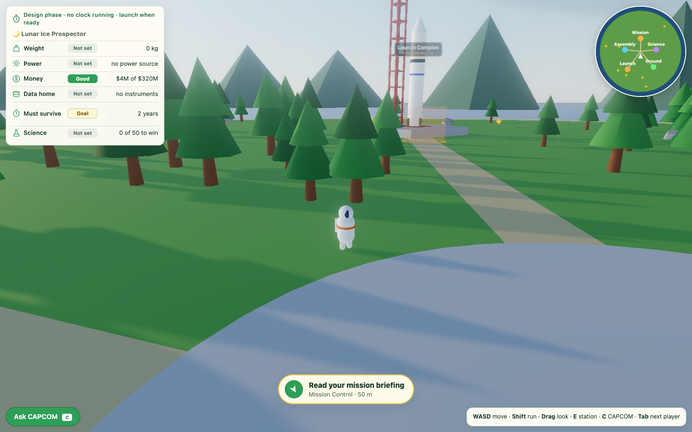

> Mission Island is an independent student project created for the *Space Mission Design Game* challenge of the NASA Space Apps Challenge 2026. It is not a NASA product and is not endorsed by NASA.

---

## The Problem

Designing a space mission is a chain of connected trade-offs. A better instrument returns more science, but it also adds mass, draws more power, produces more data than the antenna can send home, and costs money that could have bought a bigger rocket. Students rarely get to try a whole mission themselves, and most learning tools teach one topic at a time (orbits, or rockets, or spacecraft). The trade-offs between them stay abstract.

Mission Island turns those trade-offs into something you can try, fail at, understand, and try again.

## The Game

The player starts with a science objective, not a ready-made spacecraft. Every decision must serve that objective and survive the realities of space.

1. **Read the mission.** Mission Control explains the goal, the money limit, how long the spacecraft must survive, and which real NASA missions tackled the same question.
2. **Walk the island and design.** Five buildings, each a part of the mission:
   - **Launch Complex:** where to go (6 orbits) and which rocket gets you there (4 launch vehicles).
   - **Assembly Hangar:** the spacecraft itself: structure, power, battery, flight computer, pointing system, engine, and on the Moon mission a rover.
   - **Science Lab:** which of 10 instruments to fly.
   - **Ground Station:** antenna, ground network, relay, and how much of the time the instruments observe.
   - **Mission Control:** the design review, which blocks the launch until the design is physically possible.
3. **Launch.** A short cinematic, and the rocket can fail at its real reliability.
4. **Fly.** The mission runs day by day. Solar panels age, radiation strikes, data piles up faster than it can be sent home, and surprise events demand decisions.
5. **Shadowline (Moon mission).** Land near the lunar south pole and plan a rover route into a permanently shadowed crater to find ice, then get back to sunlight before the battery dies.
6. **Debrief.** A grade, a plain-language explanation of what went well and what to fix, and a side-by-side comparison with the closest real NASA mission.

A full run takes about ten minutes, and the report always leads back to the island to improve the design.

## Visual Tour

<table>
  <tr>
    <td>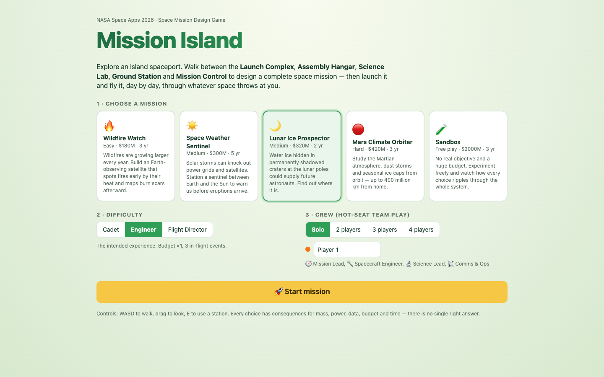 Choose one of five missions</td>
    <td>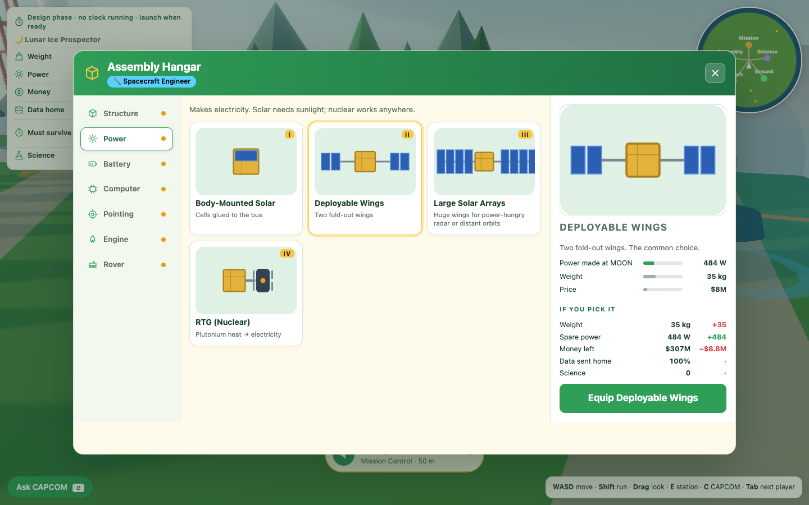 Pick parts; every choice previews its effect</td>
  </tr>
  <tr>
    <td>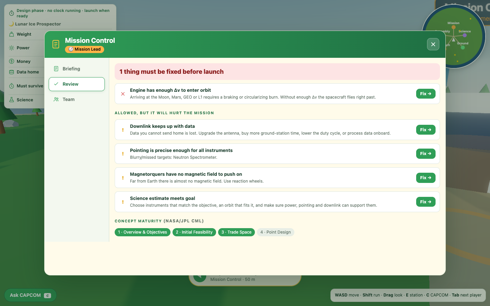 The design review blocks impossible launches, with Fix buttons</td>
    <td>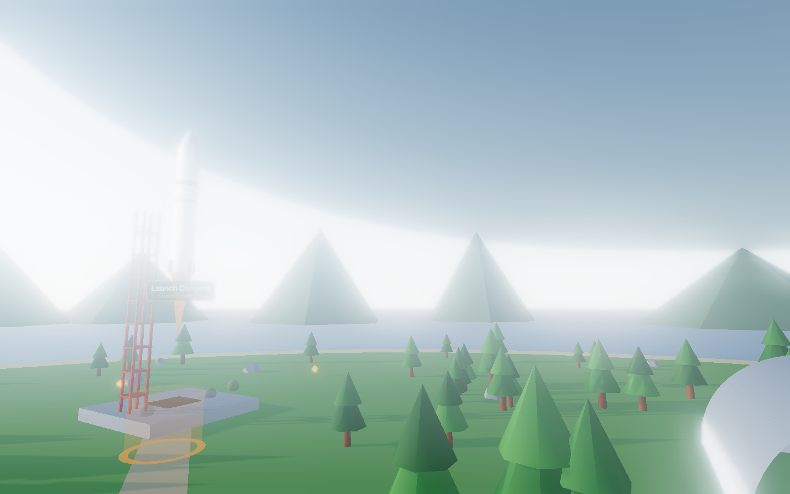 Launch</td>
  </tr>
  <tr>
    <td>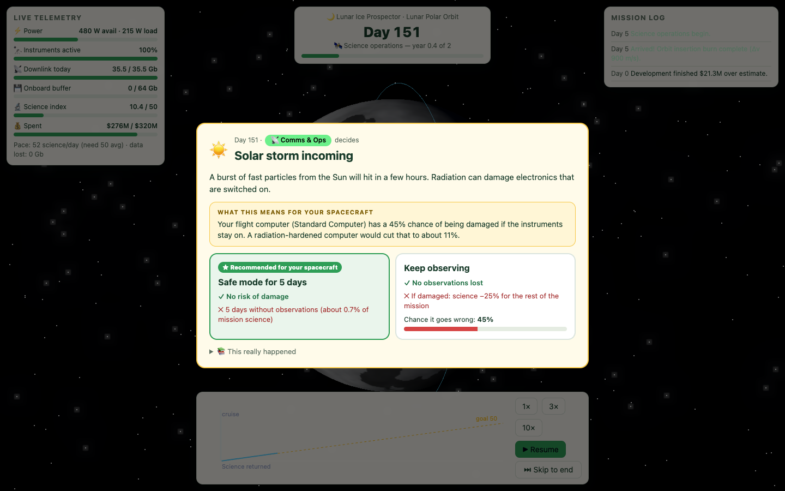 In-flight events explain the risk for your spacecraft</td>
    <td>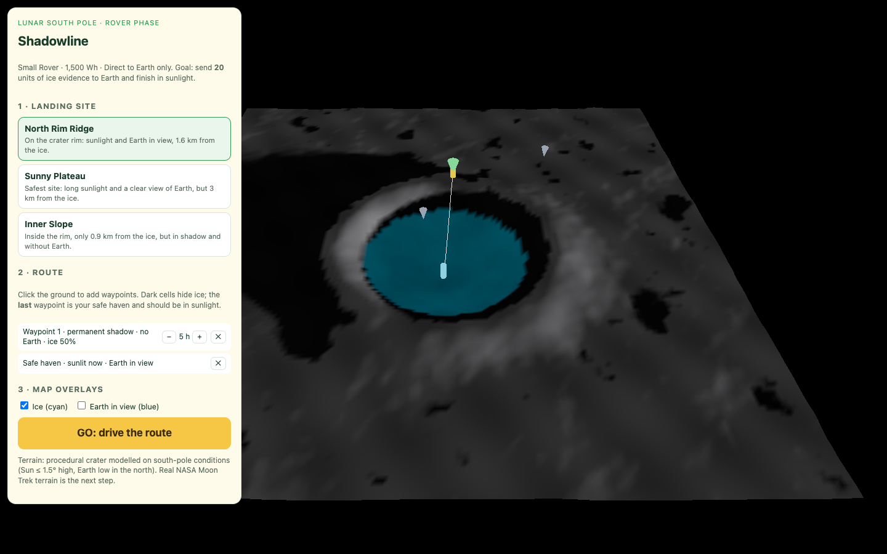 Shadowline: plan a route into the dark crater (ice in cyan)</td>
  </tr>
  <tr>
    <td>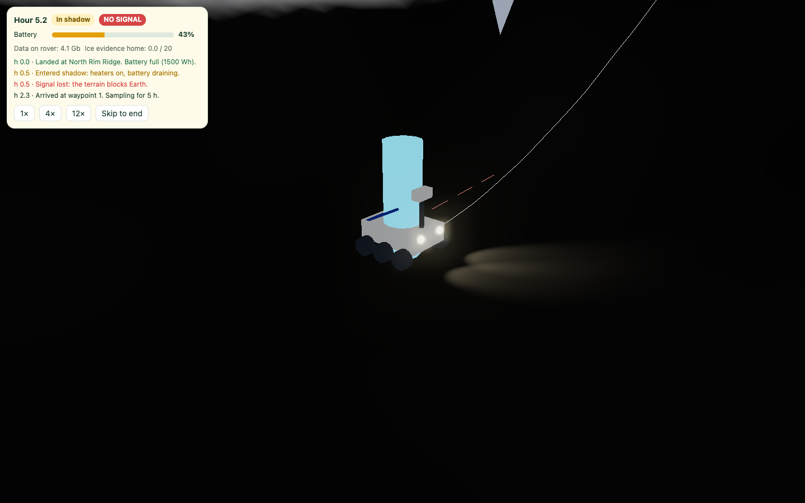 In the dark: no sunlight, no signal, battery draining</td>
    <td>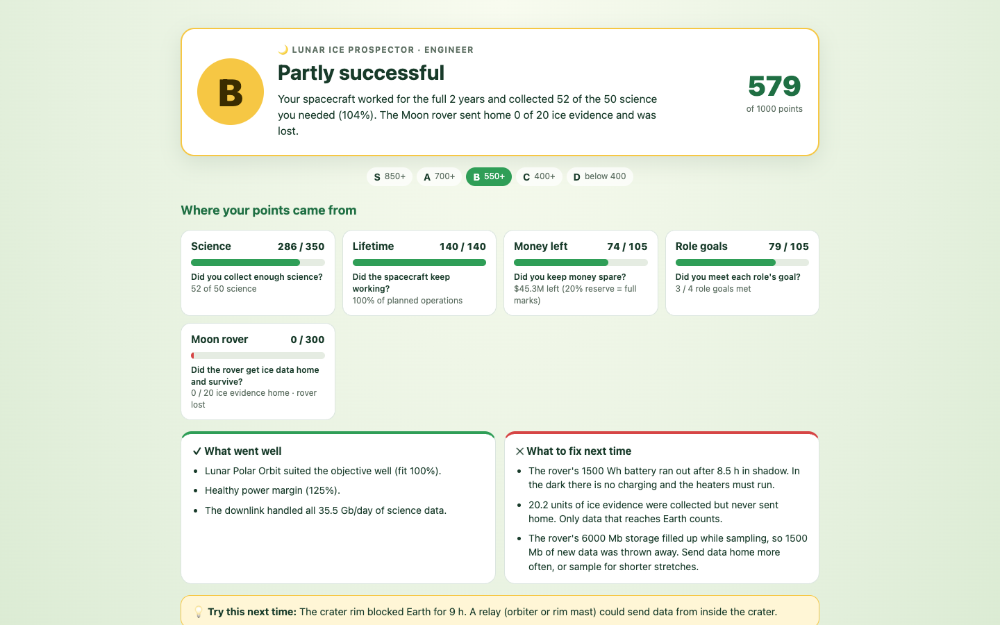 The debrief: grade, reasons, and what to fix</td>
  </tr>
</table>

## Missions

| Level | Mission | Difficulty | Goal | What makes it hard |
|---|---|---|---|---|
| 1 | **Wildfire Watch**: spot wildfires from orbit and map burn scars | Easy | 45 science in 3 years, $180M | Thermal and hyperspectral images produce more data than a small antenna can send home |
| 2 | **Space Weather Sentinel**: warn Earth about solar storms from the L1 point | Medium | 40 science in 5 years, $300M | Radio links at 1.5 million km and a long lifetime |
| 3 | **Lunar Ice Prospector**: map water ice at the Moon's south pole, then drive into a crater | Medium | 50 science in 2 years, $320M, plus the rover | Batteries in permanent shadow, and crater rims that block radio contact with Earth |
| 4 | **Mars Climate Orbiter**: study dust storms and ice caps from Mars orbit | Hard | 42 science in 3 years, $420M | 43% sunlight, a braking burn to enter orbit, and a slow interplanetary radio link |
| 5 | **Sandbox** | Free play | None | Nothing: experiment and compare reports |

There is no single correct design for any mission. Different combinations of orbit, rocket, parts and instruments can all succeed.

## How It Works

### Six resources

| Resource | What it means |
|---|---|
| **Weight** | Spacecraft mass. It must fit both the structure's carrying limit and the rocket's capacity to the chosen orbit; rockets lift far less to the Moon or Mars than to low orbit. |
| **Power** | Electricity made versus used, averaged over the time spent in a planet's shadow. Solar power fades with distance from the Sun; nuclear power works anywhere but produces little. |
| **Money** | Parts, assembly and testing, the rocket, and the flight team for every year of the mission. Real projects run over budget, so spare money matters. |
| **Data home** | How much of the science data the antenna and ground stations can send to Earth each day. Data that does not fit is lost. |
| **Must survive** | How long the spacecraft has to keep working, plus the travel time to far destinations. |
| **Science** | The score that decides whether the mission succeeds. |

### The design review

Some problems **block the launch** because the mission is physically impossible: the rocket cannot reach the orbit, the spacecraft is too heavy, the engine cannot brake into orbit, or the money has run out. Other problems are **allowed but costly**: not enough power, a battery too small for eclipses, an antenna too slow for the data, or aiming that is too coarse for a telescope. The game explains each one and offers a *Fix* button that jumps straight to the right choice.

### Science

Every instrument has a base value, and how much of it counts depends on how well it suits the mission, whether the orbit lets it see its target, whether the spacecraft can aim it precisely enough, whether there is power to keep it switched on, and how much of its data reaches Earth. The most valuable data is always sent first, so a weak antenna hurts data-hungry instruments most. A great instrument is worth little without the power, pointing and radio to support it.

### In-flight events

Seven kinds of event can strike during flight: a solar storm, a reaction wheel failure, a ground station outage, a budget cut, space junk on a collision course, a micrometeoroid strike, and an unexpected discovery. Each event explains what it means *for your spacecraft* using its real numbers (for example, the chance that a standard computer is damaged by radiation compared with a radiation-hardened one), shows what each choice gains and costs, marks the option the numbers favour, and is linked to a real event from NASA's history.

### Shadowline

Near the lunar south pole the Sun never rises more than about 1.5 degrees above the horizon, and Earth sits low in the sky. Crater rims cast shadows that last for billions of years and block radio signals. Shadowline computes, for every spot on the terrain, whether the Sun and Earth are visible, then simulates the rover every fifteen minutes: battery, heaters in the dark, slopes, and data held versus sent home. The rover can find the ice, collect excellent data, and still be lost if it runs out of power before reaching sunlight or never regains contact with Earth. Only data that reaches Earth counts.

### Scoring

Missions are scored out of 1,000 points for science returned, how long the spacecraft kept working, money left over, and the goals of each team role; on the Moon mission the rover adds its own share. Grades run from S to D. The debrief puts the result in plain words, lists what went well and what to fix, and gives one concrete tip for the next attempt.

### Team play

Up to four players share one screen, each taking a role: **Mission Lead**, **Spacecraft Engineer**, **Science Lead** and **Comms & Ops**. Each role owns its buildings and has its own goal, and the goals pull against each other: the scientist wants more instruments, the engineer wants safety margins, the lead wants money left over. Everyone must sign off on the design before launch, and in-flight decisions go to the role responsible.

### Ask CAPCOM

CAPCOM is the mission controller players can ask at any time ("Why is my data bar red?", "What should I fix first?"). Before suggesting anything it tests the change in the game's simulator, and every suggestion comes with an *Apply* button. CAPCOM can use Claude to answer in natural language, grounded in the simulator's numbers; without an AI key it still works, using the simulator alone. The AI never decides outcomes: the simulation does.

## Grounded in Real Science

- **Orbital physics from real constants.** Orbit periods, speeds and time spent in shadow are calculated from the real radii and gravitational parameters of Earth, the Moon and Mars. Sunlight at Mars follows the inverse-square law.
- **A real mission archive.** Sixteen NASA and partner missions, including Landsat 8, Terra, SOHO, ACE, DSCOVR, the Solar Dynamics Observatory, the Lunar Reconnaissance Orbiter, Lunar Prospector, the Mars Reconnaissance Orbiter, MAVEN and the lost Mars Climate Orbiter, are used for comparisons, briefings and lessons.
- **Real events.** In-flight events are paired with real cases such as Kepler's reaction wheel failures, the micrometeoroid strike on JWST's mirror and the May 2024 geomagnetic storm.
- **NASA's own frameworks.** Progress follows JPL's Concept Maturity Levels, and the game is organised around NASA's four mission segments: launch, space, ground and user.
- **VIPER-inspired surface operations.** Shadowline's rules follow the challenges NASA planned around for the VIPER rover: blocked radio, long blackouts and sunlit safe havens.

Values are simplified for gameplay. The Shadowline terrain is currently a procedural crater modelled on south-pole conditions; real NASA Moon Trek elevation data can be loaded in its place.

## Tech Stack

| Layer | Technology | What it does in Mission Island |
|---|---|---|
| Web framework | **Next.js 16** (App Router) with **React 19** | Serves the page, bundles the code, and runs the one server route |
| 3D graphics | **Three.js 0.160** | The island, launch, orbit views and the Shadowline crater; sky, reflections and glow (bloom) |
| Game engine | **Plain JavaScript modules** | Every rule and number: parts, orbits, physics, design review, science, flight, events, rover, scoring |
| Server code | **TypeScript** + **Zod** | The Ask CAPCOM route; Zod checks every request before it reaches the engine |
| AI (optional) | **Anthropic SDK** + **Claude** | Natural-language CAPCOM answers; Claude calls the engine through tools for every number |
| Styling | Hand-written **CSS** | Green, yellow and off-white theme, game-style menus, HUD and report |
| Saved data | Browser **localStorage** | Per-browser leaderboard. No database and no accounts |
| Hosting | **Vercel** | Free hosting with a global CDN, one serverless function, automatic deploys |
| Code | **GitHub** | Source of truth; every push to `master` redeploys the live site |

## Infrastructure

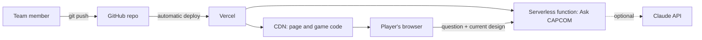

- **Almost everything runs in the player's browser.** The page, the 3D, the engine and the leaderboard need no server at all, so the game is fast and cheap to host.
- **One small server function** answers Ask CAPCOM. It checks the request, limits how often one player can ask, runs the engine on the server, and, only if an AI key is set, asks Claude to phrase the answer. Without a key it answers from the engine alone, so the game never depends on the AI.
- **Settings live in Vercel → Environment Variables:** `ANTHROPIC_API_KEY` (optional) and `AI_MODE` (`live` or `off`).

## Architecture

The game has three layers. The rule that holds it together: **the simulation engine decides every number; the screens and the AI only show and explain it.**

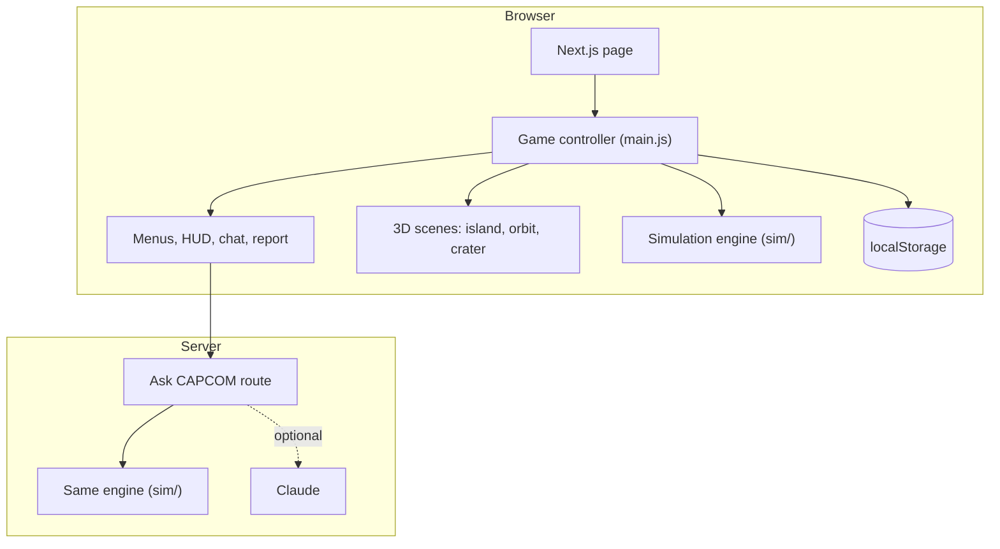

**What happens when a player makes a choice**

1. The player clicks *Equip* on a part in a station menu.
2. The game controller updates the design.
3. The engine recalculates mass, power, money, data, science and the design review, instantly and in the browser.
4. The resource panel, the guide and the 3D spacecraft on the hangar stand update.
5. If the player asks CAPCOM for help, the design goes to the server route, which tests changes in the same engine and sends back answers with *Apply* buttons.

**The simulation engine** (`mission-island-web/src/game/sim/`), pure JavaScript with no graphics:

| File | Responsibility |
|---|---|
| `data.js` | All game content: missions, orbits, rockets, parts, instruments, roles, difficulty |
| `physics.js` | Orbit periods, speeds and shadow time from real planetary constants |
| `model.js` | Turns a design into mass, power, data, cost, science and the design-review checks; writes the debrief reasons |
| `sim.js` | Flies the mission day by day and scores it |
| `events.js` | The seven in-flight events, their personalised explanations and recommendations |
| `surface.js` | Shadowline: terrain, sunlight and Earth visibility, rover simulation |
| `nasa.js` | The real-mission archive, real-world cases and NASA frameworks |

**The game client** (`mission-island-web/src/game/client/`), what the player sees:

| File | Responsibility |
|---|---|
| `main.js` | Game controller: menus, station loadouts, HUD, guide, flight screen, events, report, CAPCOM chat, main loop |
| `world.js` | The 3D island, buildings, astronaut, camera, launch sequence |
| `space.js` | The orbit view during flight |
| `shadowline.js` | The 3D crater, route planning and rover playback |
| `models.js`, `illus.js` | 3D models (spacecraft, rockets, planets) and the menu illustrations |
| `game.css` | All styling and the colour theme |

**The server** (`mission-island-web/src/game/server/capcom.ts` and `src/app/api/capcom/route.ts`): request checks, rate limit, the five CAPCOM tools, the Claude call and the offline fallback.

**Where to change things**

| I want to… | Edit |
|---|---|
| Change a part's mass, power or price, or add an instrument | `sim/data.js` |
| Change how science or the design review works | `sim/model.js` |
| Add or change an in-flight event | `sim/events.js` |
| Change the rover phase rules | `sim/surface.js` |
| Change a menu, the HUD or the report | `client/main.js` |
| Change colours or layout | `client/game.css` (theme colours are at the top of the theme section) |
| Change the island or buildings | `client/world.js` |
| Change what CAPCOM says or can do | `server/capcom.ts` |

**More documentation** in [`docs/`](docs/):

- [`docs/ARCHITECTURE.md`](docs/ARCHITECTURE.md): the full target architecture (AI features, database, Moon Trek pipeline, testing).
- [`docs/build-map.html`](docs/build-map.html): the team build map, with diagrams, screen mock-ups, game rules and what is built versus planned. Open it in a browser; an online copy is at [claude.ai/artifact/XsLoBsXiyQwNYLtZpVdddU](https://claude.ai/artifact/XsLoBsXiyQwNYLtZpVdddU).
- [`docs/screenshots/`](docs/screenshots/): screenshots of the game.

## Running Locally

Requires Node.js 20 or later. From `mission-island-web/`, install dependencies with `npm install` and start the game with `npm run dev`. To enable AI answers in Ask CAPCOM, copy `.env.example` to `.env.local` and add an Anthropic API key.

## How Mission Island Answers the Challenge

The challenge asks for a game where players design, manage and simulate a complete space mission. This is how each part of the brief is covered.

| The challenge asks for | Mission Island |
|---|---|
| Start from a mission objective | Every run starts at Mission Control with a science goal, a budget and a required lifetime, before any part is chosen |
| Design the spacecraft | Assembly Hangar: structure, solar or nuclear power, battery, flight computer, pointing system, engine, and a rover on the Moon mission |
| Select scientific instruments | Science Lab: 10 instruments, each with its own mass, power, cost, data rate and science value |
| Choose a launch vehicle and orbit | Launch Complex: 6 orbits and 4 rockets with real-style payload limits per destination |
| Check mass and orbit against the rocket | The design review blocks launch if the rocket cannot lift the spacecraft to the chosen orbit |
| Manage budget, mass, power, communications, data and lifetime | Six resources shown in plain words on screen the whole time, each with a green / yellow / red state |
| Show how one decision affects the rest | Every option card shows its effect on weight, power, money and data before you pick it |
| No single perfect solution | Many designs pass each mission; the debrief compares yours with the real NASA missions that took different routes |
| Mission simulation and evaluation | Launch with real reliability, day-by-day flight, ageing panels, radiation, data backlog, then a score out of 1,000 |
| Random events and unexpected constraints | 7 in-flight events (solar storm, budget cut, space junk and more), each tied to a real NASA case |
| Up to four players with different roles | Hot-seat team play: Mission Lead, Spacecraft Engineer, Science Lead, Comms & Ops, each with its own goal and a sign-off before launch |
| Feedback that explains *why* | Each design problem is explained with a *Fix* button; the debrief says what went well, what to fix and gives one tip |
| Difficulty levels and mission types | 3 difficulty levels (Cadet, Engineer, Flight Director) and 5 missions from Easy to Hard, plus a Sandbox |
| Fly again and improve | Every report leads back to the island with the design kept |
| Leaderboards, saving and sharing | A leaderboard per mission, and a link that shares your full design |
| Interactive visualisation | A 3D island, launch, orbit view and the Shadowline crater on the Moon |
| Accessible to beginners | Plain-word labels, a bottom-centre quest guide, illustrations on every option, and Ask CAPCOM for questions |

Not covered yet: development time as a resource (only mission lifetime is modelled), simpler parts on lower difficulty, and a competitive mode where several teams fly the same mission. These are on the roadmap below.

## Challenge Resources: How We Used Them

The challenge's [Resources tab](https://www.spaceappschallenge.org/2026/challenges/space-mission-design-game/?tab=resources) lists NASA and partner material. Here is what we took from each one, and where we have not used it yet.

| Resource | How Mission Island uses it | Status |
|---|---|---|
| **Design and Develop Science Missions** (NASA) | The four mission segments shape the island: the Launch Complex is the launch segment, the Hangar and Science Lab the space segment, the Ground Station the ground segment, and the debrief the user segment (what scientists get back) | Used |
| **Concept Maturity Levels** (JPL) | CML 1–4 is the progress ladder at Mission Control: idea, feasible concept, trade study, point design. The design review must pass before launch | Used |
| **Mission Design Lab** (NASA Goddard) | The design review checks the same disciplines the MDL studies (power, propulsion, communications, attitude control, mass, cost, risk), and the option cards are small trade studies. An AI review board in the MDL style is planned | Partly used |
| **A Learning Game About Telescopes** | We follow its pattern: objective first, choices limited by what fits the objective, an animated launch, results from your design, and real NASA missions with similar goals | Used |
| **General Mission Analysis Tool (GMAT)** | Not run inside the game. Orbit periods, speeds and eclipse times use the same physics GMAT starts from (real gravitational constants and radii), simplified to first order so the game runs in a browser | Simplified |
| **NASA Mission Viz** | Not used directly. Our launch and orbit view is our own Three.js scene; Mission Viz is a reference for a future, more accurate trajectory view | Not yet |
| **CubeSat 101** (NASA CSLI) | The smallest spacecraft bus is a small-satellite option, but we have not yet modelled CubeSat sizes or the CubeSat process | Not yet |
| **Visualize a Space Mission Using VR** (2023 challenge) | Its idea of showing the concept, trajectory, timeline and 3D view of a mission matches our launch, flight timeline and 3D scenes; we did not build VR | Inspired |
| **CSA Digital Games and Activities** | Looked at as examples of short, friendly space games for young players | Inspired |

## Other NASA Data Used

- **Real mission facts** from NASA mission pages and histories: Landsat 8, Terra, Suomi NPP, ECOSTRESS, NISAR, SOHO, ACE, DSCOVR, SDO, LRO, Lunar Prospector, MRO, Mars Odyssey, MAVEN, Mars Climate Orbiter and PACE.
- **VIPER's operations concept** (blocked radio, long blackouts, sunlit safe havens) shapes Shadowline.
- **NASA Moon Trek** lunar elevation data is the planned replacement for the procedural crater.

## Use of AI

- **In the game:** Ask CAPCOM can use Claude (Anthropic) to answer players in plain language. Claude never decides outcomes; every number it uses comes from the game's own simulator, and the game works fully without it.
- **In development:** the team used Claude as a coding and design assistant.

## Status

**Playable now:** all five missions, island design with the full design review, launch, day-by-day flight with in-flight events, the Shadowline rover phase, scoring and debrief, Ask CAPCOM (offline, with optional AI), hot-seat team play, and per-browser leaderboards and share links.

**Next:** real NASA Moon Trek terrain for Shadowline; touch controls for phones and tablets; development time as a resource; simpler parts on lower difficulty; a class competition mode where teams fly the same mission; an AI design review board and mission debrief; automated tests; a student playtest with a before-and-after quiz.

## Team

*Add team member names here.*

## License

Code is released under the [MIT License](LICENSE).

## Credits

NASA mission facts are drawn from public NASA mission pages and histories and simplified for gameplay. NASA names are used for reference only and do not imply endorsement.
