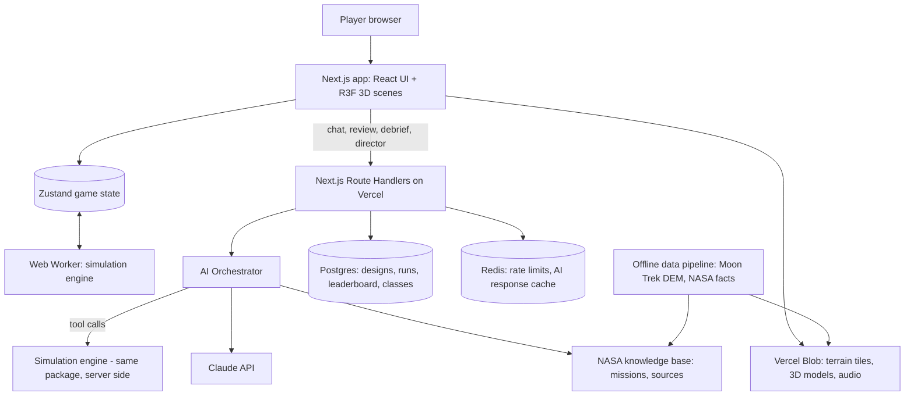
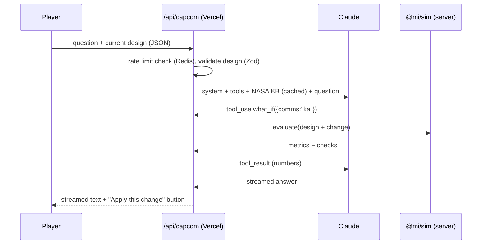

# Mission Island: Full Architecture (Vercel + AI)

**Project:** NASA Space Apps 2026, *Space Mission Design Game* challenge
**Recommended stack:** Next.js + TypeScript + React Three Fiber + Claude API, hosted on Vercel
**Date:** November 13, 2026

---

## 0. Problem and goal

**Problem:** designing a space mission is a chain of connected trade-offs. A better instrument adds mass, power, data and cost. Students rarely get to try a whole mission themselves, and most tools teach one topic at a time, so the trade-offs stay abstract.

**Goal:** the player designs a complete mission on an explorable 3D island, launches it, and flies it. On the Moon mission, they then drive a rover into a dark crater (Shadowline). An AI mission controller ("CAPCOM") coaches them, reacts to their choices and explains every outcome. The engineering result always comes from a deterministic simulation, never from the AI.

---

## 1. What happens when a player opens the app?

The player opens a **Vercel URL** in the browser. There's nothing to install, no account is needed, and they get an anonymous player ID.

1. **Menu:** pick a mission (Lunar Ice Prospector is featured), a difficulty, and optionally a teacher's class code.
2. **Island (design phase):** walk an astronaut between five buildings. Each one holds one kind of decision:
   - **Mission Control:** the objective, real NASA missions for reference, design review.
   - **Launch Complex:** orbit and rocket.
   - **Assembly Hangar:** spacecraft parts, plus the rover for the Moon mission.
   - **Science Lab:** instruments.
   - **Ground Station:** antenna, ground network, relay.
3. **Ask CAPCOM:** at any time, the player can ask the AI why a bar is red or what would happen if they swapped a part. The AI answers with real numbers from the simulation.
4. **AI Design Review Board:** before launch, the AI reviews the design like NASA's Mission Design Lab. It gives three suggestions, each one tested by the simulation first.
5. **Launch:** a cinematic rocket sequence.
6. **Flight:** day-by-day simulation. The AI Mission Director picks surprise events from a safe list and speaks as CAPCOM on the radio.
7. **Shadowline (Moon):** plan a rover route into a shadowed crater on real NASA Moon Trek terrain, then watch it play out.
8. **Debrief:** grade, score, an AI-written debrief grounded in the actual results, a comparison with the closest real NASA mission, and a leaderboard.

**Important:** the simulation is the source of truth. The AI chooses words and suggests events, but it can never change a number, a score, or an outcome.

---

## 2. Architecture overview



**Key idea:** one simulation package (`@mi/sim`) runs in three places:

- In a Web Worker in the browser, for instant feedback at 60 fps.
- On the server, as the tools the AI calls.
- On the server again, to verify leaderboard scores so nobody can cheat.

---

## 3. Components

| Component | What it means | What it does in the game | Technology |
|---|---|---|---|
| **Web App / UI** | Screens and controls | Menu, HUD resource bar, station panels, chat, report | Next.js App Router, React, Tailwind, shadcn/ui, Framer Motion |
| **3D Renderer** | Draws the worlds | Island, launch, orbit view, Shadowline crater | React Three Fiber, drei, @react-three/postprocessing |
| **Physics / movement** | Walking and collisions | Astronaut controller, building colliders | @react-three/rapier |
| **Game State** | The record of the current game | Design, phase, players, progress; triggers redraws | Zustand (+ persist to localStorage) |
| **Simulation Engine** | The engineering rules | Mass, power, data, cost, orbits, flight days, events, rover energy and line of sight, scoring | Pure TypeScript package `@mi/sim`, deterministic, seeded RNG |
| **Sim Worker** | Keeps the game smooth | Runs heavy work (flight sim, horizon maps) off the main thread | Web Worker + Comlink |
| **AI Orchestrator** | The "brain" around Claude | Builds prompts, runs tool loops, validates AI output, falls back to scripts | Next.js Route Handlers (Node runtime), `@anthropic-ai/sdk`, Zod |
| **Claude API** | The language model | CAPCOM chat, Mission Director, Review Board, Debrief, Scenario Builder | `claude-opus-5-5` (main), `claude-haiku-5-5` (eval judge) |
| **NASA Knowledge Base** | The game's facts | Mission archive, real-world event cases, CML levels, data sources, each with a source URL | JSON in repo, loaded into cached prompt context |
| **Database** | Long-term records | Saved designs, flight runs, leaderboard, classes, playtest quiz answers | Postgres (Neon via Vercel Marketplace) + Drizzle ORM |
| **Cache / rate limits** | Protects cost and speed | Per-player AI limits, cached debriefs, idempotency | Upstash Redis (Vercel Marketplace) |
| **Asset storage** | Big files | Moon terrain tiles, horizon maps, GLB models, audio | Vercel Blob + CDN |
| **Data pipeline** | Prepares real data offline | Converts Moon Trek elevation into game tiles and precomputes horizon maps | Python (GDAL, NumPy), run locally or in GitHub Actions |
| **Observability** | Knowing what broke | Errors, performance, AI cost per session | Vercel Analytics + Speed Insights, Sentry, OpenTelemetry spans |

---

## 4. What the AI does (and never does)

| AI feature | When | What it produces | How it is kept honest |
|---|---|---|---|
| **Ask CAPCOM** (tutor chat) | Any time on the island | Plain-language answers, "what if" comparisons | Must call tools for every number; system prompt forbids invented figures |
| **Design Review Board** | Before launch (the CML 4 gate) | 3 ranked recommendations, each a concrete design change | The server runs every suggested change through the simulation and shows only ones that actually improve the design |
| **Mission Director** | During flight, at event slots | Which event happens next + CAPCOM radio line | Structured output; event must come from the allowed catalog and pass preconditions; otherwise the scripted picker is used |
| **Mission Debrief** | After the mission | A short story of what happened and why, plus lessons | Input is the simulation's result object and log only; references NASA archive entries by ID |
| **Scenario Builder** (teacher mode) | Teacher creates a class | A new mission scenario (objective, goal, budget, instrument relevance) | Zod schema + a solver that checks at least one winning design exists before saving |

**The AI never:** decides outcomes, edits numbers, changes scores, or invents NASA facts. If the AI is slow, down, or over budget, every feature falls back to scripted text, so the game always works.

---

## 5. Exact flow when a player makes a decision

**Scenario:** in the Science Lab the player adds a high-resolution telescope.

1. **UI:** the player clicks the telescope card (hovering first shows a preview of how each bar would move).
2. **Game State:** stores the new design.
3. **Sim Worker:** recalculates mass, power, data and cost in under 5 ms.
4. **UI:** the data bar turns red, and a one-line "why" appears: *"Your antenna can send 144 of 250 Gb/day."*
5. **Player asks CAPCOM:** "How do I fix the data problem?"
6. **AI Orchestrator:** Claude calls `what_if({ comms: "ka" })` and `what_if({ gs: "dsn" })`. Each runs on the server simulation.
7. **Claude replies** with the real numbers it got back: "Ka-band gets you 100% downlink for +$8M; the Deep Space Network gets 92% for +$24M over 3 years."
8. **Player** walks to the Ground Station and picks Ka-band. The bars turn green.

---

## 6. Exact flow of the AI tool loop (Ask CAPCOM)



**Tools exposed to Claude** (all read-only, all run the deterministic engine):

| Tool | Input | Returns |
|---|---|---|
| `get_metrics` | design | mass, power, data, cost, science estimate, checks |
| `what_if` | design + list of changes | before/after metrics for each change |
| `explain_check` | check id | the rule, the numbers, what fixes it |
| `compare_missions` | design | closest real NASA missions and why |
| `lookup_fact` | topic | a NASA knowledge-base entry with its source URL |

---

## 7. Claude API details

| Topic | Choice |
|---|---|
| SDK | `@anthropic-ai/sdk` in Next.js Route Handlers (Node runtime), API key only on the server |
| Main model | `claude-opus-5-5` for all player-facing AI features |
| Thinking and effort | Adaptive thinking (default). `output_config.effort`: `low` for Mission Director and quick chat (fast), `medium` for debrief, `high` for Design Review Board |
| Streaming | `client.messages.stream(...)` for chat, review and debrief, piped to the browser |
| Tool loop | SDK Tool Runner with Zod tools (`betaZodTool`) and `strict: true`. Tool choice is `auto`: forced tool choice is not supported on this model |
| Structured output | Mission Director and Scenario Builder use `client.messages.parse()` with a Zod schema (`output_config.format`) |
| Prompt caching | Stable prefix first: tool definitions → system prompt → NASA knowledge base, with a cache breakpoint after it; the player's design and question come after. Verify with `usage.cache_read_input_tokens` |
| Refusals | Check `stop_reason` before reading content; server-side fallback enabled (`fallbacks: "default"` with the `server-side-fallback-2026-07-01` beta) |
| Errors | Typed SDK errors: retry 429/5xx with backoff, then fall back to scripted text |
| Evals judge | `claude-haiku-5-5` grades AI answers in the eval suite (cheap, runs in CI) |

**Grounding rules in the system prompt:**

- Every number must come from a tool result in this conversation.
- Explain why, in plain words, for a 14-year-old.
- Never claim a NASA fact that isn't in the knowledge base.
- Stay in character as a friendly CAPCOM, under about 120 words unless asked for more.

---

## 8. Shadowline: data and simulation flow

```text
NASA Moon Trek south-pole elevation (LOLA)          [offline, once]
   ↓  Python pipeline: crop, resample to 512×512, 20 m cells
Height tiles (.bin) + precomputed horizon maps (64 directions)
   ↓  uploaded to Vercel Blob, loaded by the browser
@mi/sim surface module
   ↓  every simulated 15 minutes:
   ├─ Sun visible?   (sun azimuth/elevation vs horizon map) → solar power
   ├─ Earth visible? (or relay mast / orbiter pass)        → radio contact
   ├─ battery: E = clamp(E + (P_solar − P_load) × Δt, 0, E_max)
   └─ data collected vs data sent home
   ↓
3D crater scene shows exactly what the simulation computed
(lit vertices = sunlit cells, red signal line = no contact)
```

**The surprising failure:** the rover reaches the ice and collects great data, but the crater rim blocks Earth. Without a relay, the battery runs out before the safe haven, and the data never reaches home. The debrief then shows the hour it lost signal and the hour the battery hit zero.

---

## 9. Data model (Postgres)

| Table | Key fields | Used for |
|---|---|---|
| `players` | id (anonymous UUID), display name, class_id | Leaderboard names, class membership |
| `designs` | id, player_id, scenario, design JSON, created_at | Save, share links (`/d/[id]`), compare |
| `runs` | id, design_id, seed, result JSON, score, verified | Mission history; leaderboard only shows `verified = true` |
| `classes` | id, code, teacher name, scenario_ids | Teacher mode |
| `scenarios` | id, author, scenario JSON, validated | Built-in + AI-built scenarios |
| `quiz_answers` | player_id, phase (pre/post), answers | Measuring learning for the judges |
| `ai_events` | session, feature, tokens in/out, latency, fallback_used | Cost and reliability dashboard |

**Score verification:** when a run is submitted, `/api/runs` re-runs `@mi/sim` on the server with the same design and seed. The run counts only if the results match.

---

## 10. Repository structure

```text
mission-island/
├─ apps/
│  └─ web/                     Next.js app (deployed to Vercel)
│     ├─ app/
│     │  ├─ page.tsx                menu
│     │  ├─ play/page.tsx           the game
│     │  ├─ d/[id]/page.tsx         shared design page
│     │  ├─ teacher/page.tsx        teacher mode
│     │  └─ api/
│     │     ├─ capcom/route.ts      tutor chat (streaming + tools)
│     │     ├─ review/route.ts      design review board
│     │     ├─ director/route.ts    in-flight event choice
│     │     ├─ debrief/route.ts     mission debrief
│     │     ├─ scenarios/route.ts   scenario builder
│     │     └─ runs/route.ts        save + verify runs, leaderboard
│     ├─ components/          UI (HUD, panels, chat, report)
│     ├─ scenes/              R3F scenes (island, launch, orbit, crater)
│     ├─ workers/sim.worker.ts
│     └─ lib/ai/              orchestrator, prompts, tools, fallbacks
├─ packages/
│  ├─ sim/                    @mi/sim: pure TypeScript engine + tests
│  ├─ content/                game data + NASA knowledge base (JSON, with sources)
│  └─ db/                     Drizzle schema + migrations
├─ pipeline/                  Python: Moon Trek DEM → tiles + horizon maps
├─ evals/                     AI eval sets + runner
└─ e2e/                       Playwright tests
```

Monorepo with pnpm workspaces + Turborepo.

---

## 11. Deployment on Vercel

| Piece | How |
|---|---|
| Hosting | Vercel project linked to the GitHub repo; every pull request gets a preview URL |
| AI routes | Node.js runtime Route Handlers with streaming responses (Fluid compute) |
| Static and 3D assets | Next.js static files + Vercel Blob for terrain and models |
| Database | Neon Postgres through the Vercel Marketplace (env vars injected) |
| Redis | Upstash through the Vercel Marketplace |
| Secrets | `ANTHROPIC_API_KEY`, `DATABASE_URL`, `UPSTASH_*`, `BLOB_READ_WRITE_TOKEN` in Vercel environment variables |
| AI switch | `AI_MODE = live | mock | off` env var: `mock` returns recorded answers for demos and tests |
| Monitoring | Vercel Analytics, Speed Insights, Sentry |

---

## 12. Cost, safety and reliability

- **Rate limits:** a set number of AI calls per player per hour, and a daily cap for the whole app (Redis).
- **Caching:** prompt caching on the stable prefix. The debrief is cached by a hash of the run result, so the same run never pays twice.
- **Fallbacks:** every AI feature has a scripted fallback (the current game's text), so a demo never shows a blank screen.
- **Input safety:** player chat is treated as data. The AI can only call read-only tools, and the design JSON is validated with Zod before use.
- **Kid-safe tone:** the system prompt keeps answers on space and engineering topics and politely declines anything else.
- **Privacy:** anonymous IDs, no emails, no tracking beyond aggregate analytics.

---

## 13. Testing and evals

| Layer | Tool | What it checks |
|---|---|---|
| Simulation | Vitest | Physics matches known values, every scenario is winnable, determinism (same seed → same result), line-of-sight correctness |
| UI flows | Playwright | Full mission from menu to report, with `AI_MODE=mock` |
| Performance | Playwright + Speed Insights | 60 fps on the island, under 3 s first load |
| AI quality | `evals/` runner, `claude-haiku-5-5` as judge | Answers use tool numbers, are accurate, kid-friendly, short, and never invent facts; Director picks valid events |
| Learning | In-game pre/post quiz | Did players learn the trade-offs (for the judges' slides) |

---

## 14. Build order (MVP first)

1. **Port the engine:** move the current `model.js`, `sim.js` and `physics.js` into `@mi/sim` (TypeScript) with Vitest tests.
2. **Next.js shell on Vercel:** the menu, the island in R3F, the HUD resource bar, station panels, a working launch and flight.
3. **Ask CAPCOM:** first AI feature end to end (tools + streaming + fallback).
4. **Shadowline:** terrain pipeline, surface simulation, crater scene, route planning.
5. **More AI:** Design Review Board, Mission Director, Debrief.
6. **Database:** saved designs, verified leaderboard, share links.
7. **Polish:** lighting, launch cinematic, audio, quality presets.
8. **Teacher mode + Scenario Builder** (stretch).
9. **Ship:** playtest with quiz, evals green, 30-second video, submit.

**Never cut:** the full design → flight → report loop, the deterministic engine, AI fallbacks, the live URL.

---

## 15. Risks

| Risk | Fallback |
|---|---|
| The heavier stack takes longer than expected | Steps 1–3 already make a strong submission; the current static game stays deployable as a backup |
| AI latency or cost too high | `low` effort, short answers, caching, rate limits, `AI_MODE=mock` for the video |
| AI says something wrong | Tools-only numbers, evals in CI, Review Board suggestions verified by the simulation |
| Moon Trek export is slow to process | Procedural crater labelled as such; swap in real tiles later |
| Space Apps rules on AI use | Check the rules and disclose AI use on the project page |

---

**In one sentence:** the player designs a mission in a 3D world, a deterministic simulation decides what happens, Claude explains it and coaches them using only the simulation's numbers and real NASA sources, and Vercel serves it all from one link.
